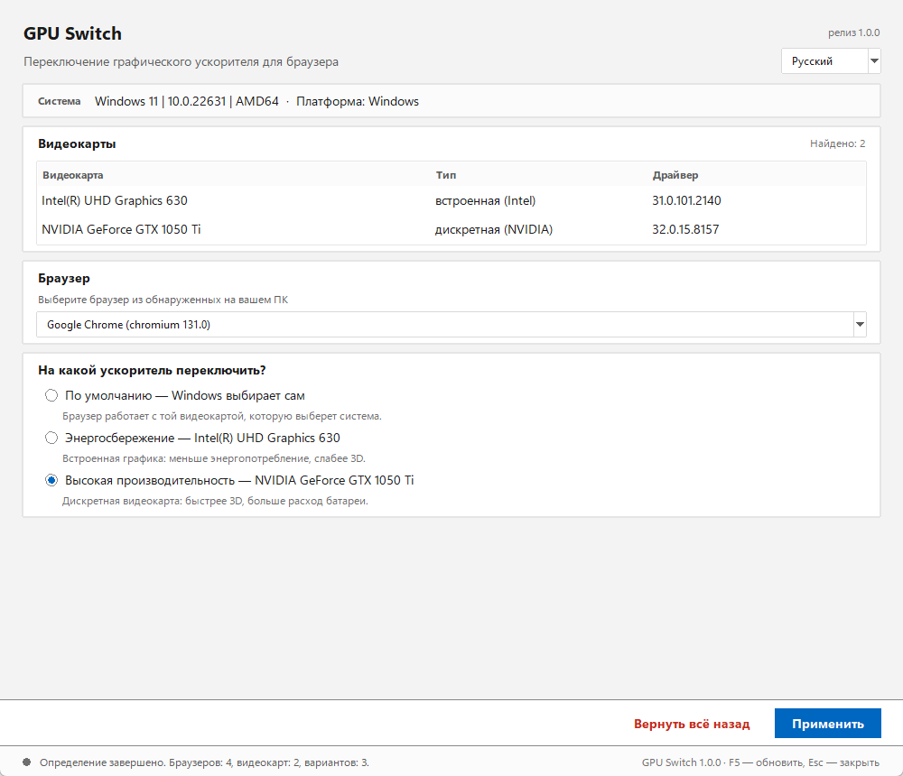
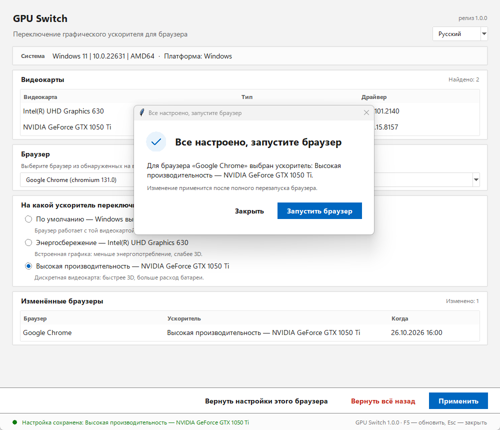

# GPU Switch

Небольшая настольная программа для Windows и Linux, которая переключает графический ускоритель (видеокарту) для выбранного браузера. Всё работает в рамках текущего пользователя — права администратора не нужны. Интерфейс оформлен в стиле Windows 11: карточки с тонкой рамкой, Segoe UI Variable, системный акцентный цвет.

```
Windows 11 · Python 3.9+ · Tkinter · без сторонних библиотек
Готовый один файл BrouserGPUSwitch.exe собирается скриптом build_exe.bat
```

## Зачем это нужно

На ноутбуках и ПК с двумя видеокартами (встроенная Intel/AMD и дискретная NVIDIA/AMD) браузер по умолчанию может работать на слабой встроенной графике. GPU Switch позволяет выбрать для Chrome, Edge, Firefox, Yandex Browser и других браузеров принудительное использование дискретной видеокарты — и так же просто вернуть всё назад.

## Что умеет

1. Определяет операционную систему (Windows 10/11 или Linux), её версию и архитектуру.
2. Находит установленные браузеры (реестр StartMenuInternet и известные пути в Windows; .desktop-файлы в Linux).
3. Определяет графические чипы: встроенные, дискретные и виртуальные.
4. Показывает окно с выбором: «Выберите браузер из обнаруженных на вашем ПК».
5. Подставляет в список ускорителей тот вариант, который действует для браузера сейчас: он отмечен выбранным.
6. Позволяет выбрать, на какой ускоритель переключить.
7. Просит закрыть браузер и проверяет, что он действительно закрыт (по процессам).
8. Меняет настройки в системе — только для текущего пользователя.
9. После смены показывает окно «Все настроено, запустите браузер» с кнопкой запуска этого браузера.
10. Всегда доступная кнопка «Вернуть всё назад» отменяет все сделанные программой изменения.

## Как это выглядит



*Главное окно: карточки «Система», «Видеокарты», «Браузер», выбор ускорителя и закреплённая внизу акцентная кнопка «Применить».*



*После смены настройки: «Все настроено, запустите браузер» с кнопкой запуска браузера.*

## Языки

Интерфейс переведён на пять языков: **русский**, **английский**, **китайский**, **испанский**, **немецкий**.

Язык выбирается в списке в правом верхнем углу главного окна — рядом с номером версии. При первом запуске подставляется язык системы (или ранее сохранённый). После выбора окно сразу перезапускается уже на новом языке, а выбор запоминается в `settings.json` рядом с данными программы (см. «Где хранятся данные») и используется при следующих запусках.

Переводятся только элементы интерфейса программы. Названия видеокарт, браузеров и версии — это системные данные, они остаются как есть. Служебные режимы командной строки (`--self-test`, `--diagnostics`) всегда печатают отчёт по-русски.

## Требования

* Windows 10 (1803 и новее) или Windows 11, либо Linux с X11/Wayland.
* Python 3.9+ с Tkinter.
  * Windows: [python.org](https://www.python.org/downloads/) — Tkinter входит в установщик.
  * Debian/Ubuntu: `sudo apt install python3-tk`
  * Fedora: `sudo dnf install python3-tkinter`
  * Arch: `sudo pacman -S tk`
* Никаких сторонних Python-пакетов не требуется.
* Для готового `BrouserGPUSwitch.exe` Python и Tkinter не нужны — см. «Готовый `.exe`».

## Запуск

Windows:

```bat
run.bat
```

или из командной строки:

```bat
py -3 main.py
```

Linux:

```sh
chmod +x run.sh
./run.sh
```

или:

```sh
python3 main.py
```

Демонстрационный режим (ничего не меняет на компьютере, показывает демо-данные):

```
python main.py --mock
```

## Готовый `.exe` (Python не нужен)

Программу можно упаковать в `BrouserGPUSwitch.exe`: внутри уже есть и интерфейс, и Tkinter, поэтому на компьютере, где он запускается, Python устанавливать не нужно. Сборка — обычный PyInstaller, никаких изменений в коде для неё не требуется.

Собрать самому (один раз нужен интернет — для установки PyInstaller):

```bat
build_exe.bat
```

Скрипт проверяет Python 3.9+, при необходимости ставит PyInstaller и собирает сразу два варианта:

* `dist\BrouserGPUSwitch.exe` — один файл, около 11–12 МБ, копируется и переносится как обычный exe;
* `dist\BrouserGPUSwitch\BrouserGPUSwitch.exe` — папка с exe и служебными файлами рядом, запускается быстрее и надёжнее на «закрытых» машинах (см. «Если exe не запускается»).

Оба варианта проходят самопроверку в конце сборки. Для пользователей папку удобно отдать архивом: `Compress-Archive dist\BrouserGPUSwitch\* dist\BrouserGPUSwitch-windows.zip`.

Если проект лежит на GitHub, то же самое собирается автоматически: вкладка **Actions** → **build-exe** → **Run workflow**, готовые файлы появятся в присоединённых файлах запуска (artifact). При отправке тега вида `v1.0.0` exe и zip прикладываются к релизу — так их можно отдавать пользователям ссылкой.

Как ведёт себя собранный файл:

* при двойном щелчке открывается только окно программы — **консольного окна нет вообще**: exe собран как оконное приложение, поэтому не мелькает даже чёрный прямоугольник;
* права администратора не нужны: в манифесте exe стоит `asInvoker`, все изменения пишутся в профиль текущего пользователя (`HKCU` в Windows, `~/.config` и `~/.local/share` в Linux). Если Windows показывает запрос прав администратора — это не программа, а оболочка/антивирус; запускайте exe из обычной пользовательской папки, а не из `C:\Program Files`;
* при первом запуске подставляется язык системы, а сменить его можно в списке в правом верхнем углу окна;
* в режимах командной строки (`BrouserGPUSwitch.exe --self-test`, `BrouserGPUSwitch.exe --diagnostics`) программа подключается к консоли, из которой её запустили, и печатает отчёт туда. Оболочка не ждёт оконную программу, поэтому приглашение может вернуться раньше отчёта; если это мешает — перенаправьте вывод в файл: `BrouserGPUSwitch.exe --diagnostics > report.txt`;
* настройки и откат работают как обычно, данные лежат в `%APPDATA%\BrowserGpuSwitch\`;
* exe собирается под Windows. На Linux PyInstaller делает исполняемый файл без расширения, но собрать его нужно именно на Linux — `build_exe.bat` для этого не подходит.

### Если exe не запускается

**«Система Windows защитила ваш компьютер»** (SmartScreen) — это не ошибка программы. exe не подписан платной электронной подписью, поэтому Windows предупреждает о неизвестном издателе. Нажмите «Подробнее» → «Выполнить в любом случае». Для публичного распространения без такого предупреждения нужна подпись кода.

**«Error. Could not create temporary directory!»** — так ведёт себя однофайловая сборка, когда система или антивирус запрещают распаковку во временный каталог `%TEMP%`. Это ограничение one-file режима PyInstaller, а не программы. Решение — запустить сборку в папку: `dist\BrouserGPUSwitch\BrouserGPUSwitch.exe` (она ничего не распаковывает и в `%TEMP%` не пишет). Ту же папку можно собрать вручную:

```bat
python -m PyInstaller --noconfirm --clean packaging\gpu-switch.spec
```

Если exe нужно перенести на другой компьютер, копируйте папку целиком — exe без служебных файлов рядом не запустится.

## Как пользоваться

1. Запустите программу; язык интерфейса можно сразу сменить в списке в правом верхнем углу окна. Дождитесь окончания определения системы, браузеров и видеокарт.
2. В блоке «Выберите браузер из обнаруженных на вашем ПК» выберите браузер.
3. В блоке «На какой ускоритель переключить?» уже отмечен вариант, который действует сейчас.
4. В блоке «На какой ускоритель переключить?» выберите нужный вариант.
5. Если браузер запущен, программа попросит закрыть его полностью и нажать «Проверить снова». Кнопка «Применить» станет доступна только после того, как процессы браузера завершатся.
6. Нажмите «Применить». Появится окно «Все настроено, запустите браузер» с кнопкой «Запустить браузер».
7. Чтобы отменить изменения, нажмите «Вернуть всё назад» и подтвердите действие.

## Что именно меняется в системе

### Windows

Используется пользовательская настройка Windows «Параметры графики»:

```
HKCU\Software\Microsoft\DirectX\UserGpuPreferences
```

* Имя значения — полный путь к exe-файлу браузера, например `C:\Program Files\Google\Chrome\Application\chrome.exe`.
* Данные значения — строка вида `GpuPreference=2;`, где `0` — по умолчанию, `1` — энергосбережение (встроенная графика), `2` — высокая производительность (дискретная графика).
* Остальные поля строки (если они есть) сохраняются.
* При откате удаляется только то, что создала программа; если значение существовало до неё, возвращается исходное содержимое.

Изменение вступает в силу после полного перезапуска браузера. Эта возможность поддерживается Windows 10 1803+ и работает для приложений, которые используют системный выбор GPU (Chromium-браузеры, Firefox и большинство игр).

### Linux

Для каждого браузера создаётся персональный запуск:

* скрипт-обёртка в каталоге данных программы (`~/.config/browser-gpu-switch/wrappers/`);
* переопределённый `.desktop`-файл в `~/.local/share/applications/` с маркером `X-BrowserGpuSwitch-Mode`.

Обёртка выставляет переменные окружения и запускает исходный браузер:

* для NVIDIA PRIME Render Offload:
  ```
  __NV_PRIME_RENDER_OFFLOAD=1
  __GLX_VENDOR_LIBRARY_NAME=nvidia
  __VK_LAYER_NV_optimus=NVIDIA_only
  ```
* для DRI_PRIME (AMD/Intel):
  ```
  DRI_PRIME=1
  ```

При откате удаляются только созданные программой обёртка и `.desktop`-файл. Чужие переопределения не затрагиваются: если для браузера уже есть сторонний `.desktop`-файл, программа откажется его перезаписывать и сообщит об этом.

## Где хранятся данные

* Windows: `%APPDATA%\BrowserGpuSwitch\`
* Linux: `~/.config/browser-gpu-switch/`
* Переопределить каталог: переменная окружения `BROWSER_GPU_SWITCH_HOME`.

В каталоге лежат:

* `state.json` — сведения о применённых настройках (нужны для отката, в том числе после перезапуска программы);
* `settings.json` — выбранный язык интерфейса (создаётся после первого выбора языка);
* `backups/` — резервные копии изменённых файлов (Linux).

Удаление каталога вручную лишает программу возможности откатить изменения — сначала используйте «Вернуть всё назад».

## Командная строка

```
python main.py                     # обычный запуск
python main.py --mock              # демо-режим, ничего не меняет
python main.py --self-test         # самопроверка без окна, код возврата 0/1
python main.py --diagnostics       # технический отчёт: ОС, GPU, браузеры, процессы, откат
python main.py --ui-smoke-test     # скрытая проверка интерфейса
python main.py --screenshot-mode   # окно для скриншота (демо-данные)
python main.py --platform windows  # принудительно выбрать бэкенд
```

У собранного `BrouserGPUSwitch.exe` те же ключи: `BrouserGPUSwitch.exe --self-test`, `BrouserGPUSwitch.exe --diagnostics`, `BrouserGPUSwitch.exe --mock` и остальные. Отчёт печатается в консоль, из которой запущен exe; для сохранения в файл: `BrouserGPUSwitch.exe --diagnostics > report.txt`.

## Ограничения и предостережения

* Настройка действует только на текущего пользователя. Другие учётные записи не затрагиваются.
* Windows: некоторые программы игнорируют системную настройку GPU и выбирают адаптер сами. Это ограничение Windows, а не программы.
* Linux: переключение работает для запуска через `.desktop`-файл (меню приложений, док). Запуск из терминала в обход `.desktop` использует настройки по умолчанию.
* Linux + Wayland: поведение зависит от композитора и драйвера; в некоторых окружениях для применения нужен повторный вход в сеанс.
* Flatpak/Snap-версии браузеров могут игнорировать переменные окружения из-за песочницы.
* NVIDIA PRIME Render Offload требует установленного проприетарного драйвера NVIDIA.
* «По умолчанию» не выбирает конкретную видеокарту — решение остаётся за операционной системой.
* Программа не устанавливает драйверы и не требует перезагрузки.
* Собранный `.exe` не подписан электронной подписью: SmartScreen может показать предупреждение «Система Windows защитила ваш компьютер» («Подробнее» → «Выполнить в любом случае»), а антивирусы иногда ложно срабатывают на сборки PyInstaller. Для публичного распространения без предупреждений нужна подпись кода.
* Однофайловая сборка распаковывается в `%TEMP%` при каждом запуске. Если система или антивирус запрещают распаковку (ошибка `Could not create temporary directory!`), используйте сборку в папку `dist\BrouserGPUSwitch\` — она ничего не распаковывает. Обе сборки делает `build_exe.bat`.
* Права администратора не требуются ни для запуска, ни для работы. Программа меняет только настройки текущего пользователя.

## Диагностика

Если браузер не находится или переключение не срабатывает:

```
python main.py --diagnostics
```

Отчёт содержит ОС, список GPU, найденные браузеры с путями, запущенные процессы, доступные варианты переключения, применённые изменения и служебную информацию бэкенда. Самопроверка:

```
python main.py --self-test
```

## Разработка

```
main.py                  точка входа CLI
app/interface.py         общий контракт (dataclasses и Protocol)
app/state.py             state.json, резервные копии, атомарная запись
app/main.py              логика CLI: self-test, diagnostics, smoke test
app/theme.py             оформление Windows 11: палитра, шрифты, ttk-стили, DPI
app/ui.py                интерфейс Tkinter (карточки, закреплённые кнопки)
app/i18n.py              переводы на 5 языков, выбор языка, settings.json
app/platforms/           бэкенды: windows, linux, mock, common
  common.py              запуск команд, чтение файлов
  mock.py                демонстрационный бэкенд
tests/                   unittest-тесты
docs/notes/              заметки по платформам
run.bat, run.sh          ярлыки запуска
packaging/gpu-switch.spec   сборка exe (PyInstaller): один файл и папка
packaging/version_info.txt  свойства файла BrouserGPUSwitch.exe (версия, описание)
build_exe.bat            сборка dist\BrouserGPUSwitch.exe и папки одной командой
devshots/                служебные скрипты для скриншотов документации
.github/workflows/       сборка exe на GitHub Actions
```

Оформление вынесено в `app/theme.py`: там палитра Windows 11 (`#F3F3F3` / белые карточки / акцент `#0067C0`), шрифтовой стек `Segoe UI Variable Text → Segoe UI → …`, шкала отступов и все ttk-стили (карточки, кнопки, комбобокс, радиокнопки, таблицы). Размеры пересчитываются от фактического DPI; в `app/main.py` перед созданием окна включается DPI-awareness, чтобы на 125–150 % текст оставался резким. Новые стили добавляйте туда, а не в `app/ui.py`.

Тесты:

```
python -m unittest discover -s tests -v
```

Сборка exe напрямую, без bat-файла:

```
python -m pip install --upgrade "pyinstaller>=6.0"
python -m PyInstaller --noconfirm --clean packaging/gpu-switch.spec
```

Скрипт `build_exe.bat` делает то же самое плюс самопроверку результата. Свой значок для exe: положите `packaging/gpu-switch.ico` — spec подхватит его сам.

Проверка синтаксиса:

```
python -m compileall app
```

Тесты не изменяют реальные настройки: Windows-бэкенд тестируется с подставным реестром и подставным списком процессов, Linux-бэкенд — с подставными каталогами sysfs/proc и временным домашним каталогом.

### Независимая проверка

Результаты QA-проверки, трассировка всех десяти требований, покрытие тестами и честный список ограничений: [docs/qa-report.md](docs/qa-report.md).

Итог: 236 тестов OK (1 пропущен по среде), 44 интеграционных теста, функциональных дефектов не найдено. Живую запись в реестр Windows и проверку запущенных процессов в песочнице проверить нельзя — логика проверена на подставных реестре и списке процессов; на обычной машине рекомендуется один контрольный запуск.

## Версия

1.0.0
